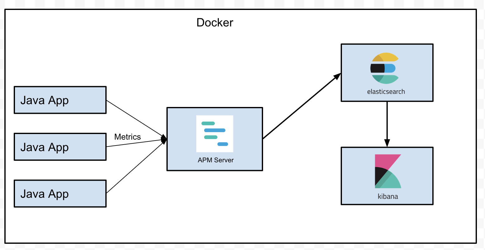
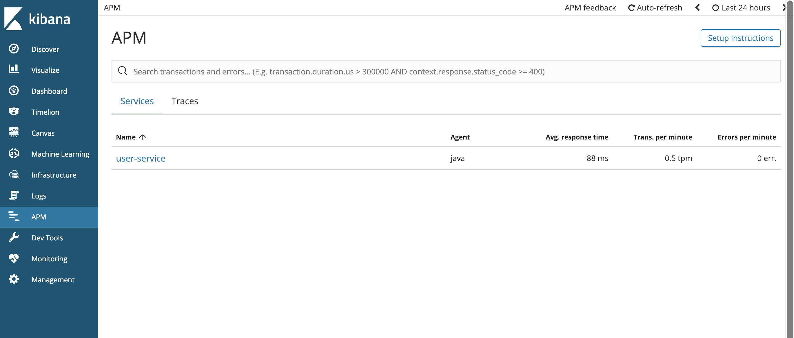
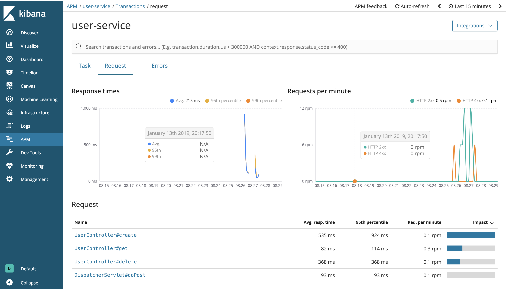
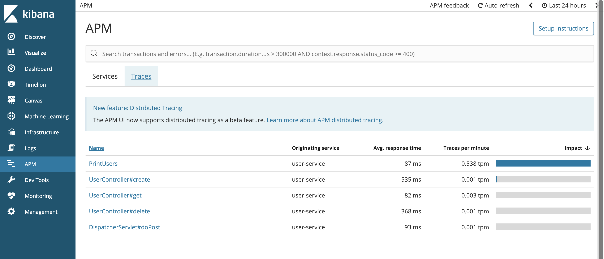
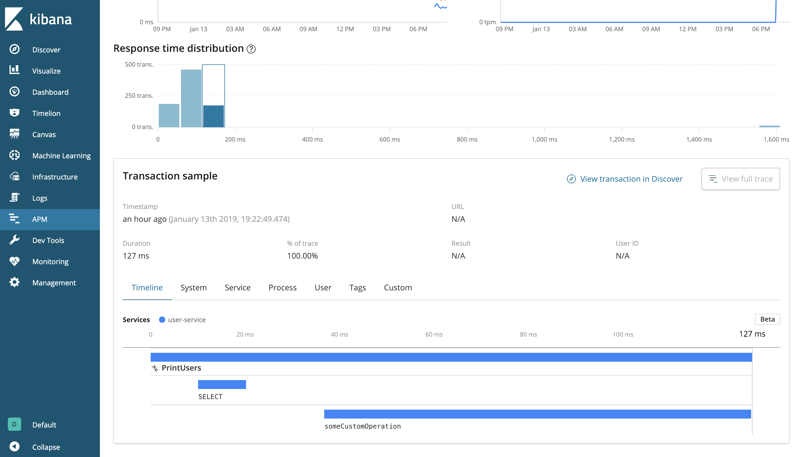

# spring-boot-elastic-apm

[](https://github.com/hendisantika/spring-boot-elastic-apm/actions/workflows/maven.yml)

Demo project to monitor a Spring Boot application using **Elastic APM**, **Elasticsearch** and **Kibana**.

For the full step-by-step tutorial, see [docs/index.md](docs/index.md).



## Tech Stack

| Component         | Version                |
|-------------------|------------------------|
| Java              | 25                     |
| Spring Boot       | 4.1.1                  |
| Elastic APM API   | 1.57.0                 |
| Elasticsearch     | 8.16.2                 |
| APM Server        | 8.16.2                 |
| Kibana            | 8.16.2                 |
| MySQL             | 9.1.0                  |
| Testcontainers    | 2.0.5                  |
| Build tool        | Maven (wrapper included) |

## Prerequisites

- JDK 25
- Docker & Docker Compose

## Features

- REST API to manage users (`/api/v1/users`)
- Scheduled background task (`PrintUsersTask`) traced with `@CaptureTransaction` and `@CaptureSpan`
- Elastic APM Java agent attached to the application container
- APM dashboards in Kibana

## Build

```shell
./mvnw clean package
```

## Run

Start the application together with MySQL, Elasticsearch, APM Server and Kibana:

```shell
docker compose up -d
```

| Service       | URL                     |
|---------------|-------------------------|
| Application   | http://localhost:8080   |
| Elasticsearch | http://localhost:9200   |
| APM Server    | http://localhost:8200   |
| Kibana (APM)  | http://localhost:5601   |

## API Endpoints

| Method | Endpoint              | Description       |
|--------|-----------------------|-------------------|
| GET    | `/api/v1/users/{id}`  | Get a user by ID  |
| POST   | `/api/v1/users`       | Create a user     |
| DELETE | `/api/v1/users/{id}`  | Delete a user     |

Example:

```shell
curl -X POST http://localhost:8080/api/v1/users \
  -H "Content-Type: application/json" \
  -d '{"name":"Hendi Santika","email":"hendi@example.com"}'

curl http://localhost:8080/api/v1/users/1
```

## Screenshots

### APM Overview



### Request Overview



### Traces



### Task Transaction Sample



## CI

GitHub Actions builds the project with JDK 25 (Temurin) on every push and pull request to `main`.
See [.github/workflows/maven.yml](.github/workflows/maven.yml).
